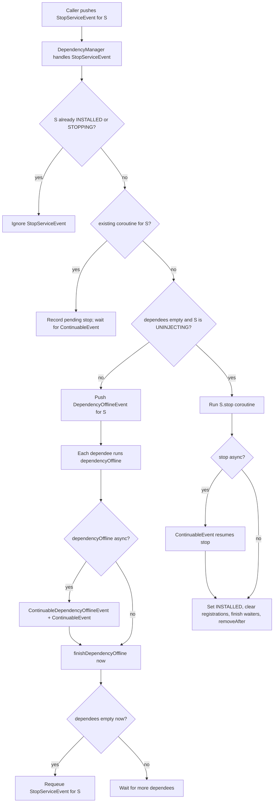
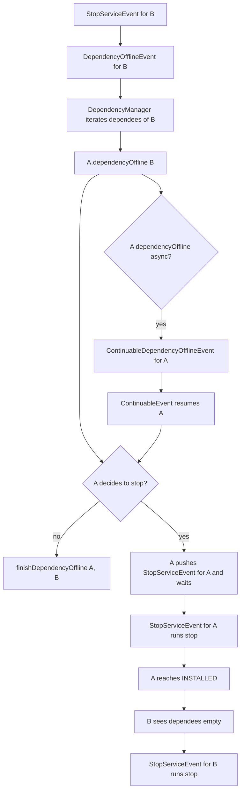
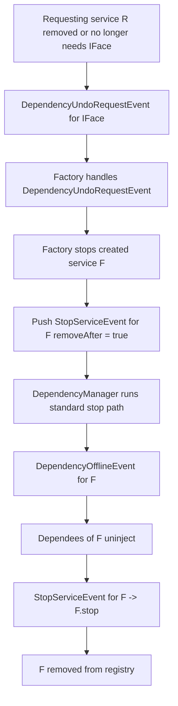
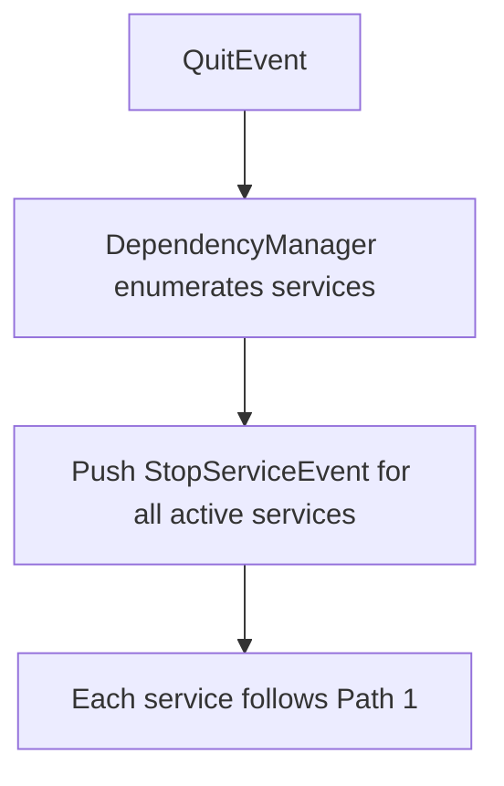

# Service Offline Paths

This document describes the main ways a service transitions to offline in Ichor and the event chains involved. It focuses on the DependencyManager event flow and how asynchronous lifecycles can delay a stop.

## Glossary

- Service states: INSTALLED -> STARTING -> INJECTING -> ACTIVE -> UNINJECTING -> STOPPING -> INSTALLED
- StopServiceEvent: request to stop a service.
- DependencyOfflineEvent: uninject a service from its dependees before stopping it.
- ContinuableDependencyOfflineEvent: internal event that resumes an async dependencyOffline coroutine.
- ContinuableEvent: internal event that resumes any async coroutine (start/stop/dependency handling).
- DependencyRequestEvent / DependencyUndoRequestEvent: used by factory-style services to create and tear down dependencies on demand.

## Path 1: Direct stop (user or framework enqueues StopServiceEvent)

Key notes:
- If any coroutine for S is still running, StopServiceEvent is deferred and retried after a ContinuableEvent completes.
- DependencyOfflineEvent is used to remove S from dependees before S.stop().

## Path 2: Dependency goes away (required dependency stops)

Example: A depends on B (required). B is stopped by any cause (direct stop or quit). A must uninject and may stop before B finishes.

Key notes:
- The dependency manager keeps B in UNINJECTING until all dependees have finished their dependencyOffline handling.
- If A uses async dependencyOffline, B waits on the ContinuableDependencyOfflineEvent path.
- If A decides to stop, A is stopped first; only after A is fully stopped does B proceed to stop.

## Path 3: Factory-driven teardown (dependency no longer required)

Factory services often create per-requesting-service instances (e.g. TimerFactoryFactory). When the requesting service is removed or its dependency is undone, the factory stops the created service.

Key notes:
- The factory path uses the same stop machinery as a direct stop, but the initiator is the factory reacting to DependencyUndoRequestEvent.
- Factories may perform async cleanup (e.g. stop timers) before pushing StopServiceEvent.

## Path 4: QuitEvent cascade (process shutdown)

QuitEvent triggers StopServiceEvent for all active services and their dependees. The same stop and dependencyOffline chain is used, but the originator is the manager.

## Async handling and delayed stops

- Any async start/stop/dependencyOffline coroutine is stored in scoped generators and resumed by ContinuableEvent.
- StopServiceEvent can be delayed if an outstanding coroutine is tied to the same service; the manager defers the stop until the coroutine completes.

## References

- Event handling: src/ichor/DependencyManager.cpp
- dependencyOffline logic: include/ichor/dependency_management/DependencyLifecycleManager.h
- Continuable events: include/ichor/events/ContinuableEvent.h
- Factory example: src/services/timer/TimerFactoryFactory.cpp
